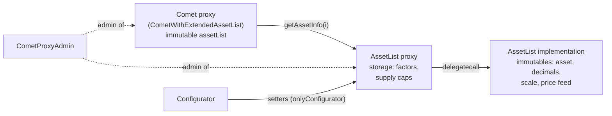
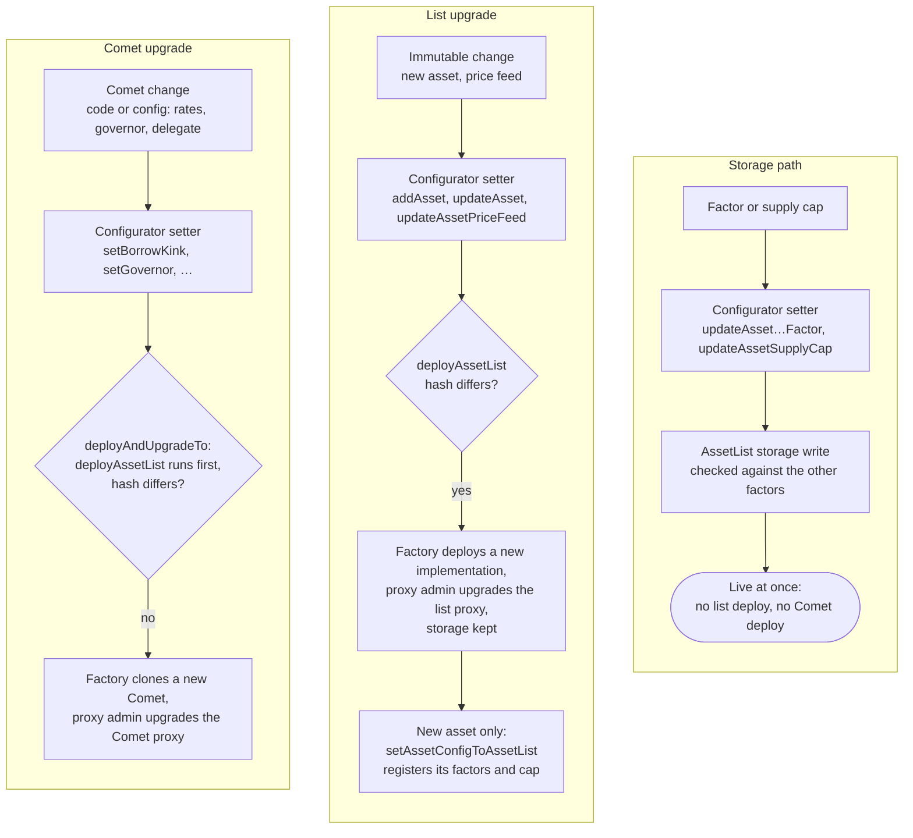

# Asset List

How `CometWithExtendedAssetList` keeps its collateral assets in a separate, upgradeable AssetList contract: what the list holds, who can change it, and which changes need a redeploy.

> Reference contracts: [`AssetList`](../contracts/AssetList.sol), [`Configurator`](../contracts/Configurator.sol), [`CometProxyAdmin`](../contracts/CometProxyAdmin.sol), [`CometWithExtendedAssetList`](../contracts/CometWithExtendedAssetList.sol), [`ConfigHash`](../contracts/libraries/ConfigHash.sol), [`AssetListFactory`](../contracts/test/assetList/AssetListFactory.sol).

---

## Table of Contents

1. [Purpose](#1-purpose)
2. [Structure](#2-structure)
3. [Roles](#3-roles)
4. [Changing a Live Asset](#4-changing-a-live-asset)
5. [Deployment Scenarios](#5-deployment-scenarios)
6. [When a Redeploy Is Needed](#6-when-a-redeploy-is-needed)
7. [Limits and Other Notes](#7-limits-and-other-notes)

---

## 1. Purpose

The AssetList holds a market's collateral assets outside Comet, so changing a factor or a supply cap no longer means a new Comet implementation.

In the old Comet every asset config is packed into Comet's own immutables. Any change, even one supply cap, needs a full Comet redeploy and proxy upgrade. The old packing also rounds factors to 4 decimals and supply caps to whole tokens.

`CometWithExtendedAssetList` keeps only the list's address, as an immutable `assetList`. Every asset read is forwarded to it:

| Comet call | Forwarded to | Returns |
|---|---|---|
| `numAssets()` | `assetList.numAssets()` | Count of listed assets |
| `getAssetInfo(i)` | `assetList.getAssetInfo(i)` | Asset, scale, price feed, factors and supply cap of the i-th asset |
| `getAssetInfoByAddress(asset)` | `assetList.getAssetInfoByAddress(asset)` | The same, found by address |

The list joins two halves in each answer: the asset, scale and price feed come from its immutables, the factors and supply cap from its storage. Factors are returned exactly as set, with no rounding.

---

## 2. Structure

Each market has one AssetList proxy (`TransparentUpgradeableProxy`). Its implementation holds the immutable half of the asset configs, and its storage holds the mutable half.

### Why a proxy

Comet stores the list's address as an immutable. If that address were the implementation itself, every new asset or price feed would need a new list and therefore a new Comet.

With a proxy, the address Comet holds never changes. A new implementation is swapped in behind it, and Comet keeps working without a redeploy. The proxy's storage, which holds the factors and supply caps, also survives the swap.

### Immutable config

`ImmutableAssetConfig` = `asset`, `priceFeed`. The asset decimals are not part of the config: the constructor reads them from the token's own `decimals()`, so they can never disagree with it. These values are read on every account health check and rarely change. Keeping them in the implementation's bytecode means a read costs no storage access: an immutable is a `PUSH`, a cold storage read is 2,100 gas.

The constructor takes up to 24 configs (`MAX_ASSETS`) and checks each one:

- neither the asset nor its price feed is the zero address;
- the price feed has 8 decimals;
- the token's decimals are at most 19, so the scale fits in `uint64`.

It also stores `numAssets`, `configHash` and `configurator`, the only address allowed to call the setters. `Configurator.deployAssetList` passes its own address, so every implementation it deploys answers only to it.

### Storage config

`StorageAssetConfig` = `borrowCollateralFactor`, `liquidateCollateralFactor`, `liquidationFactor`, `supplyCap`. These are the values risk managers change, so they live in the proxy's storage:

- `assetConfigs`: the config of each asset, keyed by asset address, so it stays with the right asset whatever its index in a new implementation.
- `assets`: an `EnumerableSet` of registered assets, so a setter rejects an unlisted asset with one lookup.

`initialize(storageConfigs)` fills storage once, in the same order as the constructor's assets, and rejects an asset listed twice.

Every write validates the factors:

- the borrow collateral factor is below the liquidate collateral factor;
- the liquidate collateral factor is below the liquidation factor;
- the liquidation factor is at most 1e18.

Zeros are allowed for de-listing (see [Limits and Other Notes](#7-limits-and-other-notes)).

### Word A and the price feed

Each asset takes two immutables: `assetNN_a` (a `uint256`) and `priceFeedAddressNN` (an `address`).

| Bits of word A | Field |
|---|---|
| 0–159 | Asset address |
| 160–167 | Decimals |
| 168–231 | Scale, 10 to the power of the decimals |
| 232–255 | Unused |

The asset, decimals and scale fit in one 256-bit word, so they are packed into it. The price feed is another 160-bit address and does not fit in the 24 bits left, so it gets its own immutable. Two immutables per asset is the fewest that hold all of it.

Unused slots past `numAssets` hold zero, which is why a zero asset address is rejected: it would look like an empty slot.

---

## 3. Roles

Only the Configurator can write to an AssetList, and only the proxy admin can swap its implementation. Governance controls both.

| Role | Contract | What it does to the asset list |
|---|---|---|
| **Governor** (timelock) | Governor of the Configurator, owner of the proxy admin | Calls every Configurator setter, sets the factories, calls `updateAssetList` |
| **Market admin** (L2s with market updates, e.g. Optimism) | `ConfiguratorOptimism` and `CometProxyAdminOptimism`, through `MarketAdminPermissionChecker` | Factor and supply cap setters, `deployAndUpgradeTo`, `deployAndUpgradeAssetListTo`. Not `addAsset`, `updateAsset` or `updateAssetPriceFeed` |
| **Configurator** | `Configurator` / `ConfiguratorOptimism` | The only caller the list's `onlyConfigurator` allows. Keeps the full `AssetConfig[]` of each market as the source of truth |
| **Proxy admin** | `CometProxyAdmin` | Admin of both the Comet proxy and the AssetList proxy. Upgrades the list when `deployAssetList` returns a new implementation |
| **Asset list factory** | `AssetListFactory` | Deploys a new implementation from the immutable configs. No access control |
| **Anyone** | — | `Configurator.deployAssetList` and `Configurator.deploy` are open: they only create contracts, which do nothing until the admin upgrades to them |

The proxy admin must be the admin of the AssetList proxy. If the list was deployed with a different admin, `deployAndUpgradeTo` fails when it tries to upgrade the list.

---

## 4. Changing a Live Asset

A factor or supply cap change is one Configurator call that takes effect at once: no new AssetList, no new Comet, no upgrade.

Each setter writes the value twice: into the Configurator's `assetConfigs`, so a later deploy uses it, and straight into the list's storage.

| Configurator setter | Calls on the AssetList | Takes effect |
|---|---|---|
| `updateAssetBorrowCollateralFactor` | `setBorrowCollateralFactor` | Immediately |
| `updateAssetLiquidateCollateralFactor` | `setLiquidateCollateralFactor` | Immediately |
| `updateAssetLiquidationFactor` | `setLiquidationFactor` | Immediately |
| `updateAssetSupplyCap` | `setSupplyCap` | Immediately |
| `setAssetConfigToAssetList` | `setAssetConfig` | Immediately. Writes all four values, and registers an asset that is new in the immutables |
| `updateAssetPriceFeed`, `updateAsset`, `addAsset` | Nothing | Only after a new list implementation (see [Deployment Scenarios](#5-deployment-scenarios)) |

Each single-factor setter checks the new value against the other two current factors, so the order of changes matters:

- to raise the borrow collateral factor above the current liquidate collateral factor, raise the liquidate collateral factor first;
- to lower the liquidate collateral factor to or below the borrow collateral factor, lower the borrow collateral factor first.

What this saves, compared with the old Comet:

- A supply cap change on one asset is one governance action, instead of a Configurator update plus `deployAndUpgradeTo`.
- No new Comet implementation is deployed, so there is no bytecode deploy cost and no new contract to verify.
- The proposal is smaller and easier to review: it shows the one value that changes.
- Values are stored exactly, with no 4-decimal rounding of factors and no whole-token rounding of caps.
- On L2s with market updates, the market admin can make these changes without a full governance proposal.

---

## 5. Deployment Scenarios

The proxy admin redeploys the AssetList only when its immutable half changed. The config hash is how it knows.

### The config hash

The constructor stores `configHash` = keccak256 of `TYPEHASH` joined with `abi.encode(immutableConfigs)`. `Configurator.deployAssetList` builds the same hash from its current `assetConfigs` and compares:

1. **Hash matches:** returns the zero address. Nothing is deployed or upgraded.
2. **Hash differs:** the factory deploys a new implementation, and the proxy admin upgrades the proxy to it.
3. **No `configHash` on the current list** (built before hashing) **or no list at all:** counts as changed, so it deploys.

Without the hash, every Comet redeploy would have to deploy an identical list, or rely on a person deciding whether it changed. With it, `deployAndUpgradeTo` always calls `deployAssetList` and pays only for a hash and a compare when nothing changed. `TYPEHASH` names the config's shape, so a future change to the immutable fields gives a different hash even for the same bytes.

The hash covers the configs, not the code. A change to the AssetList logic alone keeps the same hash, so `deployAssetList` will not deploy it.

### Change paths

A factor change stops at storage. An immutable change upgrades the list behind the same proxy. A Comet change redeploys Comet while the hash check skips the list.

### Scenarios

| Change | Governance actions | AssetList | Comet |
|---|---|---|---|
| Factor or supply cap | `updateAsset…Factor` / `updateAssetSupplyCap` | Storage write | Untouched |
| New asset | `addAsset`, `deployAndUpgradeAssetListTo`, then `setAssetConfigToAssetList` | New implementation, then the asset registered in storage | Untouched: `numAssets` is read from the list |
| Price feed | `updateAssetPriceFeed`, `deployAndUpgradeAssetListTo` | New implementation, storage kept | Untouched |
| Whole asset (`updateAsset`) | `updateAsset`, `deployAndUpgradeAssetListTo`, `setAssetConfigToAssetList` | New implementation if the immutable half changed, storage rewritten | Untouched |
| AssetList code only | Deploy the implementation outside the Configurator, then `proxyAdmin.upgrade(listProxy, impl)` | New implementation, storage kept | Untouched |
| Comet code or Comet config | Setter, `deployAndUpgradeTo` | Hash matches, nothing happens | New implementation |
| New list proxy (first migration) | Deploy and `initialize` the proxy, `updateAssetList`, `setAssetListFactory`, `setFactory`, `deployAndUpgradeTo` | New proxy | New implementation: its immutable `assetList` address changes |

A new asset needs `setAssetConfigToAssetList` after the upgrade, because `initialize` ran only once. Until that call, the asset is in the immutables but has no storage config. It reads with zero factors and a zero supply cap, so it cannot be supplied.

A new implementation's storage stays attached by asset address. `getAssetInfoByAddress` finds an asset without scanning: its position in the registered assets is its index in the immutables. To keep that true, `setAssetConfig` reverts with `AssetIndexMismatch` unless the asset's position matches its index, so new assets are registered in the order they were added.

---

## 6. When a Redeploy Is Needed

Storage values never need a redeploy. Immutable values need a new AssetList implementation. Only a change to the list's address, or to Comet's own code or config, needs a new Comet.

| What is redeployed | When |
|---|---|
| Nothing | Borrow collateral factor, liquidate collateral factor, liquidation factor, supply cap |
| AssetList implementation (proxy upgrade) | Asset added, price feed changed, AssetList code changed |
| Comet implementation | Comet code changed, or any Comet-level config: rates, kinks, governor, pause guardian, base price feed, extension delegate, tracking speeds, reserves, store front price factor |
| AssetList proxy and Comet implementation | Moving a market to the asset list for the first time, or replacing the list proxy (new `assetList` address) |

`deployAndUpgradeTo` always checks the list first, so one call covers a Comet redeploy that also carries an asset change. `deployAndUpgradeAssetListTo` upgrades the list alone when Comet does not need to change.

---

## 7. Limits and Other Notes

- **At most 24 assets per list,** the same as Comet's `assetsIn` bits allow.
- **No `removeAsset`.** An asset is retired by setting both collateral factors to 0 (fully de-listed), or only the borrow collateral factor to 0 (soft de-list: no new borrows, liquidations continue). See [Collateral Delisting](collateral-delisting.md).
- **Asset order is fixed** by the Configurator's `assetConfigs`. A new asset is always appended, so existing indexes and users' `assetsIn` bits stay valid.
- **A liquidation factor of 0** is allowed only when both collateral factors are 0, which makes the asset non-liquidatable.
