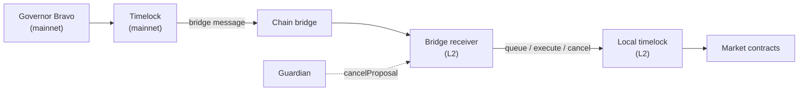
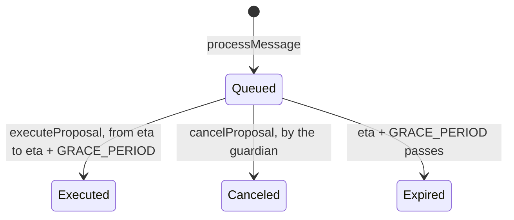

# Bridge Receiver

How governance reaches markets on L2s and sidechains: the bridge receiver queues proposals bridged from mainnet governance in the chain's local timelock, executes them, and lets a guardian cancel them before they run.

> Reference contracts: [`BaseBridgeReceiver`](../contracts/bridges/BaseBridgeReceiver.sol) (shared logic), [`SweepableBridgeReceiver`](../contracts/bridges/SweepableBridgeReceiver.sol) (token recovery), the chain receivers in [`contracts/bridges/`](../contracts/bridges/), and the interfaces in [`contracts/interfaces/bridges/`](../contracts/interfaces/bridges/).

---

## Table of Contents

1. [Overview](#1-overview)
2. [Proposal Lifecycle](#2-proposal-lifecycle)
3. [Cancellation](#3-cancellation)
4. [Deployment](#4-deployment)
5. [Replacing the Receiver](#5-replacing-the-receiver)
6. [Sweeping](#6-sweeping)
7. [Reference](#7-reference)

---

## 1. Overview

Markets on L2s have no governor of their own. Proposals are voted on mainnet, and the mainnet Timelock sends the L2 transactions through the chain's bridge to the market's bridge receiver. The receiver queues them in a **local timelock** on the L2. That local timelock governs the market (Comet, Configurator, CometProxyAdmin, ...), and the bridge receiver is its admin.



| Role | Who | Can |
|---|---|---|
| **Governing timelock** | The mainnet Timelock, fixed at deployment | Send proposals. Messages from any other sender are rejected |
| **Local timelock** | The L2 Timelock, fixed at deployment, with the receiver as its admin | Run proposal transactions. It is the only caller of `setGuardian`, the sweep functions and the chain-specific setters |
| **Guardian** | An address set at deployment, replaced only by a proposal | Cancel queued proposals |
| **Anyone** | | Execute a queued proposal from its eta; accept the timelock admin role for a receiver that is its pending admin |

Each chain has its own receiver contract, which only differs in how the bridge delivers the message. Every entry point ends in the shared `processMessage`, which rejects a message whose sender isn't the governing timelock:

| Chain | Contract | Message arrives through | Sweepable |
|---|---|---|---|
| Arbitrum | `ArbitrumBridgeReceiver` | `fallback`, called by the aliased governing timelock (retryable ticket) | Yes |
| Optimism, Base, Mantle, Unichain | `OptimismBridgeReceiver` | `fallback`, called by the L2 cross-domain messenger; the sender comes from `xDomainMessageSender()` | Yes |
| Polygon | `PolygonBridgeReceiver` | `processMessageFromRoot`, called by `fxChild` | No |
| Scroll | `ScrollBridgeReceiver` | `fallback`, called by the L2 messenger; the sender comes from `xDomainMessageSender()` | Yes |
| Linea | `LineaBridgeReceiver` | `fallback`, called by the message service; the sender comes from `sender()` | Yes |
| Ronin | `RoninBridgeReceiver` | `ccipReceive`, called by the CCIP router for messages from mainnet | Yes |

<div align="right"><a href="#table-of-contents">⬆ Back to Table of Contents</a></div>

---

## 2. Proposal Lifecycle

A bridged message is `abi.encode(targets, values, signatures, calldatas)`, the same transaction format as a Governor Bravo proposal.

**Queueing.** `processMessage` checks the four arrays have the same length (`BadData`), queues each transaction in the local timelock with `eta = block.timestamp + localTimelock.delay()`, stores the proposal under the next id and emits `ProposalCreated`. A transaction that is already queued with the same eta, for example one repeated in the message, reverts the whole message with `TransactionAlreadyQueued`.

**Execution.** Anyone can call `executeProposal(id)` from the eta until `eta + GRACE_PERIOD`, where `GRACE_PERIOD` is the local timelock's. Each transaction runs through the timelock's `executeTransaction`, and the receiver emits `ProposalExecuted`. If any transaction reverts, the whole call reverts and the proposal stays queued. Before the eta, the timelock rejects the call with its own `Transaction hasn't surpassed time lock.` message.



`state(id)` checks executed first, then canceled, then the grace period, so a canceled proposal keeps reporting `Canceled` after the time it would have expired. The `ProposalState` values are `Queued = 0`, `Expired = 1`, `Executed = 2` and `Canceled = 3`. `Canceled` was added last so the existing values didn't change for off-chain tooling.

<div align="right"><a href="#table-of-contents">⬆ Back to Table of Contents</a></div>

---

## 3. Cancellation

The guardian can stop a proposal that has been queued on the L2 and not executed yet. For example, a proposal that passed governance with a mistake, or one that is no longer safe by the time it lands.

`cancelProposal(id)`:

- can only be called by the guardian (`GuardianUnauthorized`);
- only works on a `Queued` proposal, before or after its eta, until it is executed or expires (`ProposalNotQueued`);
- marks the proposal canceled, cancels each of its transactions in the local timelock, and emits `ProposalCanceled`.

After that, `executeProposal` reverts with `ProposalNotExecutable`, and the transactions can no longer be executed through the timelock either. Other queued proposals are not affected.

**Replacing the guardian.** `setGuardian(newGuardian)` can only be called by the local timelock, so only a proposal can change the guardian. It reverts with `SameValue` if the address doesn't change, and emits `NewGuardian`. Setting it to the zero address switches cancellation off.

**The guardian can't block its own replacement.** A proposal containing a transaction that calls `setGuardian` on the receiver can't be canceled (`ProposalNotCancelable`). The check uses the function the timelock will actually call: the selector of the signature, or the first 4 bytes of the calldata when the signature is empty. So both ways of encoding the call are covered.

> **Note:** the rule applies to the whole proposal. If any of its transactions calls `setGuardian`, none of its transactions can be canceled, including the ones unrelated to the guardian.

<div align="right"><a href="#table-of-contents">⬆ Back to Table of Contents</a></div>

---

## 4. Deployment

Every receiver takes its chain-specific arguments (fxChild, messenger, message service or router; none on Arbitrum) followed by `govTimelock`, `localTimelock` and `initialGuardian`. All three must be non-zero (`ZeroValue`). The two timelocks are immutable: a receiver serves one local timelock for its whole life.

The constructor reads `localTimelock.admin()`, so the local timelock must already be deployed when the receiver is created:

- **New chain.** Deploy the local timelock with the receiver's predicted address as admin, then the receiver. The constructor sees that it is already the admin and sets `adminAccepted`, so `acceptLocalTimelockAdmin` can never be used on it.
- **Existing timelock.** The receiver starts with `adminAccepted = false` and takes the admin role over as described in [section 5](#5-replacing-the-receiver).

```ts
// New chain: the receiver is the deployer's next contract after the timelock
const receiverAddress = utils.getContractAddress({ from: deployer.address, nonce: (await deployer.getTransactionCount()) + 1 });
const localTimelock = await dm.deploy('timelock', 'vendor/Timelock.sol', [receiverAddress, delay, gracePeriod, minimumDelay, maximumDelay]);
const bridgeReceiver = await dm.deploy('bridgeReceiver', 'bridges/arbitrum/ArbitrumBridgeReceiver.sol', [govTimelock, localTimelock.address, guardian]);
```

The local development deployment ([`deployments/hardhat/dai/deploy.ts`](../deployments/hardhat/dai/deploy.ts)) follows this order. The deploy scripts of the live L2 markets predate it and still call the removed `initialize`, so they must be updated before the next new chain is deployed.

<div align="right"><a href="#table-of-contents">⬆ Back to Table of Contents</a></div>

---

## 5. Replacing the Receiver

A chain moves to a new receiver (for example, to get cancellation on an existing market) by keeping its local timelock and handing the timelock's admin role over:

1. Deploy the new receiver with the existing local timelock as `localTimelock`.
2. Through the current receiver, a proposal calls `localTimelock.setPendingAdmin(newReceiver)`.
3. Anyone calls `newReceiver.acceptLocalTimelockAdmin()`. The same proposal can also do it as its **last** transaction: `[localTimelock.setPendingAdmin(newReceiver), newReceiver.acceptLocalTimelockAdmin()]`. It has to be last, because the current receiver stays the admin until the accept, and it is the one executing the proposal's transactions.

`acceptLocalTimelockAdmin` works once (`AdminAlreadyAccepted` afterwards), and only while the receiver is the timelock's pending admin (otherwise the timelock rejects it). It is safe to leave open to anyone: the timelock is fixed at deployment, and only governance can make the receiver its pending admin.

The timelock keeps its address, so whatever it governs (the Comet governor, the ProxyAdmin owner, ...) doesn't change. After the handover:

- mainnet proposals must address the new receiver, and the market's `bridgeReceiver` root has to be updated so tooling finds it;
- proposals still queued on the old receiver can't be executed, because it is no longer the timelock's admin. Let them land before the handover, or send them again through the new receiver.

<div align="right"><a href="#table-of-contents">⬆ Back to Table of Contents</a></div>

---

## 6. Sweeping

Every receiver except Polygon's extends `SweepableBridgeReceiver`, which recovers tokens sent to the receiver by mistake. Only the local timelock can call these functions (`Unauthorized`), so a sweep is a proposal:

- `sweepToken(recipient, asset)` sends the receiver's whole balance of an ERC-20, including non-standard tokens whose `transfer` returns nothing. It reverts with `TransferOutFailed` if `transfer` returns `false`.
- `sweepNativeToken(recipient)` sends the receiver's whole native balance. It reverts with `FailedToSendNativeToken` if the recipient rejects it.

<div align="right"><a href="#table-of-contents">⬆ Back to Table of Contents</a></div>

---

## 7. Reference

**Functions** (`BaseBridgeReceiver`, declared in `IBaseBridgeReceiver`)

| Function | Caller | Effect |
|---|---|---|
| `constructor(govTimelock, localTimelock, initialGuardian)` | Deployer | Sets the timelocks and the guardian; sets `adminAccepted` if already the timelock admin |
| `acceptLocalTimelockAdmin()` | Anyone, once | Accepts the local timelock admin role |
| `setGuardian(newGuardian)` | Local timelock | Replaces the guardian |
| `executeProposal(id)` | Anyone | Executes a queued proposal from its eta |
| `cancelProposal(id)` | Guardian | Cancels a queued proposal and its timelock transactions |
| `state(id)` | View | `Queued`, `Expired`, `Executed` or `Canceled` |
| `govTimelock()`, `localTimelock()`, `guardian()`, `adminAccepted()`, `proposalCount()`, `proposals(id)` | View | Configuration and proposal data; `proposals(id)` returns `id`, `eta`, `executed`, `canceled` |

**Errors** (`IBaseBridgeReceiverErrors`, plus the two of `SweepableBridgeReceiver`)

| Error | When |
|---|---|
| `AdminAlreadyAccepted` | `acceptLocalTimelockAdmin` was already used, or the receiver was deployed as the admin |
| `BadData` | The arrays of a bridged message differ in length |
| `GuardianUnauthorized` | `cancelProposal` not called by the guardian |
| `InvalidProposalId` | Proposal id is zero or above `proposalCount` |
| `ProposalNotCancelable` | The proposal calls `setGuardian` on the receiver |
| `ProposalNotExecutable` | Executing a proposal that is executed, canceled or expired |
| `ProposalNotQueued` | Canceling a proposal that is executed, canceled or expired |
| `SameValue` | `setGuardian` with the current guardian |
| `TransactionAlreadyQueued` | A transaction of the message is already queued with the same eta |
| `Unauthorized` | A message not from the governing timelock, or a timelock-only function called by someone else |
| `ZeroValue` | A zero address passed to the constructor |
| `TransferOutFailed` / `FailedToSendNativeToken` | A sweep failed |

The chain receivers add their own errors for a wrong bridge caller (`InvalidChild`, `InvalidCrossDomainMessenger`, `InvalidL2Messenger`, `InvalidRouter`, `InvalidChainSelector`).

**Events** (`IBaseBridgeReceiverEvents`): `ProposalCreated`, `ProposalExecuted`, `ProposalCanceled`, and `NewGuardian` (on deployment, with the zero address as the old guardian, and on every replacement).

**Tests**

- Unit tests: [`test/bridges/`](../test/bridges/), one file per function (`constructor`, `process-message`, `execute-proposal`, `state`, `cancel-proposal`, `set-guardian`, `accept-local-timelock-admin`, and `sweep` for both sweep functions).
- Scenarios: [`scenario/BridgeReceiverCancelScenario.ts`](../scenario/BridgeReceiverCancelScenario.ts) cancels a queued proposal, and checks that a guardian replacement can't be canceled. It runs on deployments whose receiver supports cancellation, currently the local `development` base. [`scenario/CrossChainGovernanceScenario.ts`](../scenario/CrossChainGovernanceScenario.ts) relays and executes a proposal on every bridged base, and runs the receiver handover on Polygon, Arbitrum and Scroll.

<div align="right"><a href="#table-of-contents">⬆ Back to Table of Contents</a></div>
