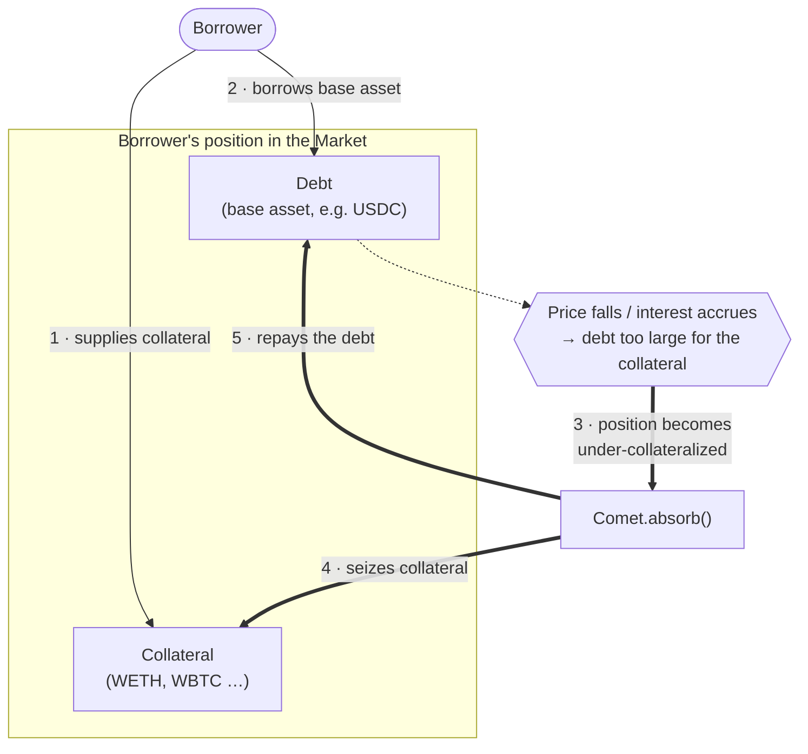
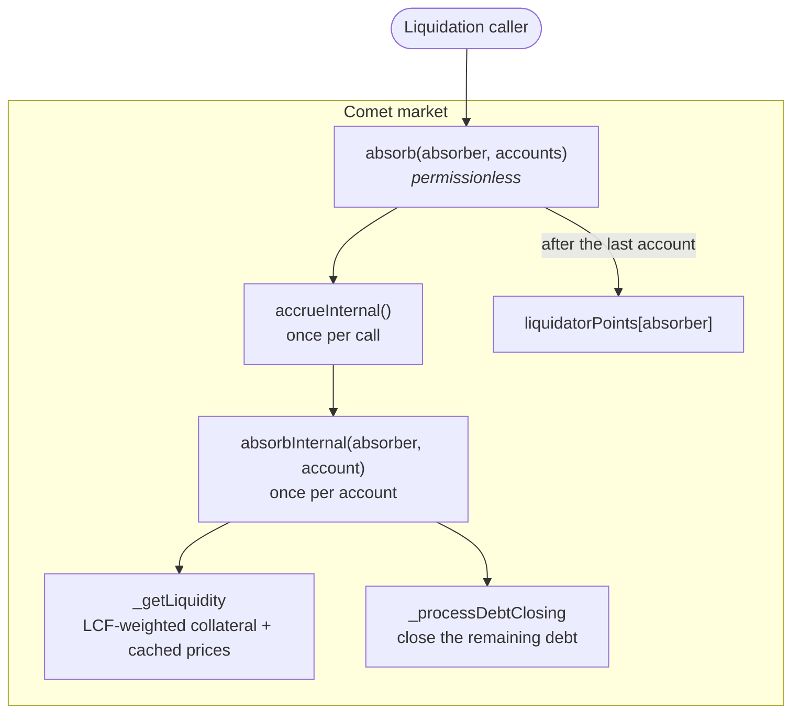
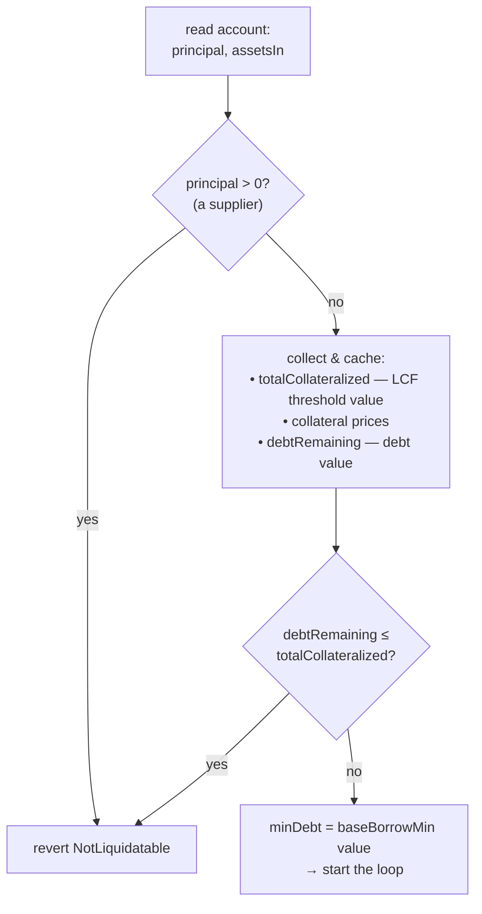
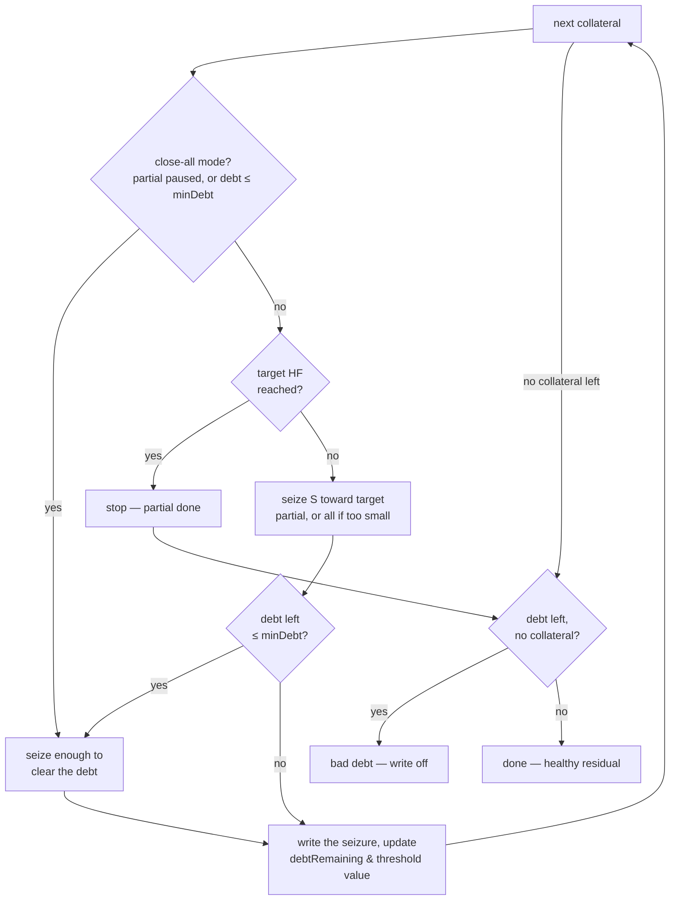
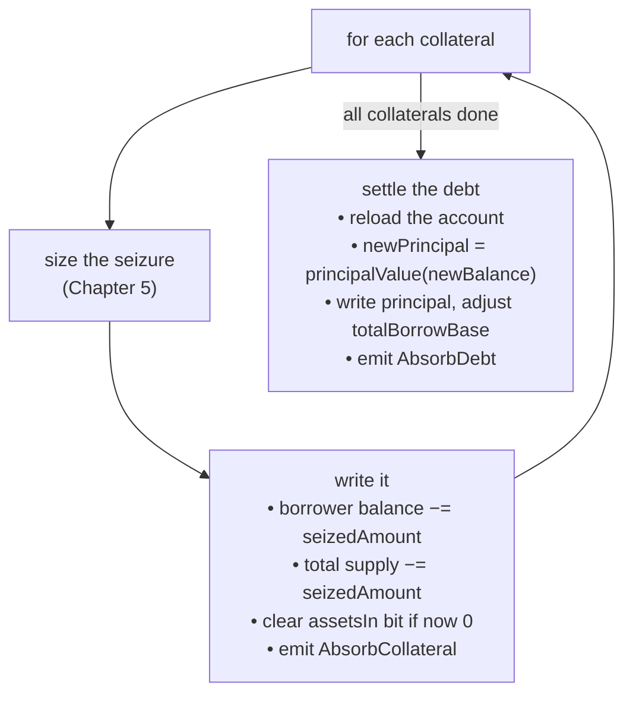
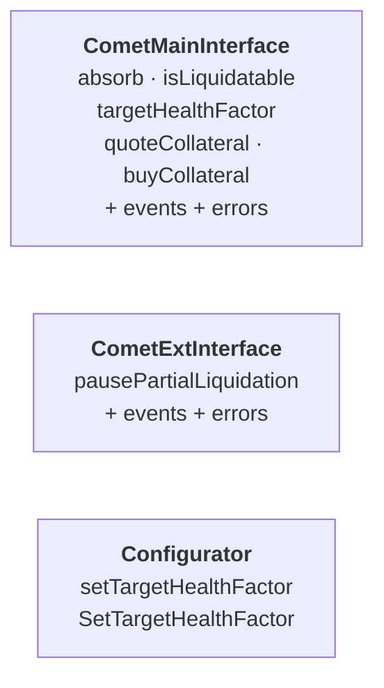

# Liquidation

How under-collateralized positions are wound down in the Comet protocol — the roles involved, the contracts that do the work, and the math behind each path.

> Reference contracts: [`CometWithExtendedAssetList`](../contracts/CometWithExtendedAssetList.sol), [`CometExt`](../contracts/CometExt.sol), [`Configurator`](../contracts/Configurator.sol).

---

## Table of Contents

1. [Overview](#1-overview)
2. [Collateral Value and Health Factor](#2-collateral-value-and-health-factor)
3. [Mechanism of Liquidation](#3-mechanism-of-liquidation)
4. [Structure of the Protocol](#4-structure-of-the-protocol)
5. [Seizure Calculation](#5-seizure-calculation)
6. [Settlement](#6-settlement)
7. [Benefits for Liquidators](#7-benefits-for-liquidators)
8. [Events](#8-events)
9. [Interfaces](#9-interfaces)

<!-- More chapters are added here as they are written. -->

---

## 1. Overview

Every borrower in Comet locks up **collateral** (volatile assets such as WETH or WBTC) in order to borrow the **base asset** (a stable asset such as USDC). The protocol only ever lends out a fraction of the collateral's value, keeping a safety buffer between what a borrower owes and what their collateral is worth.

That buffer is not permanent. Collateral prices fall, and borrow balances grow over time as interest accrues. When the two lines cross — the debt grows large enough relative to the collateral that the buffer is gone — the position is **under-collateralized**. If nothing is done, the debt could exceed the collateral entirely, leaving the protocol with a loss that lenders ultimately absorb.

**Liquidation is the mechanism that closes that gap before it becomes a loss.** When a position crosses the liquidation threshold, its collateral is seized and used to repay its debt, restoring the account to a safe state (or, in the worst case, capping the protocol's loss as early as possible). This is what keeps the base asset fully backed and lenders able to withdraw.

In Comet, this work is done by the core market contract itself. Its permissionless **`absorb()`** checks whether an account is liquidatable, decides how much of which collateral to seize, and writes the result straight into the market's balances — in one call, with no other contract involved.

### Who and what is involved

| Actor / Component | Role |
|---|---|
| **Borrower** | Supplies collateral and borrows the base asset. Their position is what gets liquidated when it becomes unhealthy. |
| **Market** (`CometWithExtendedAssetList`) | Holds all balances and prices. Its `absorb()` checks whether an account is liquidatable, computes **which collateral to take and how much**, and updates the borrower's collateral and debt. |
| **Absorber** | Whoever calls `absorb()` — anyone can. Earns liquidator points, and profits by buying the absorbed collateral back at a discount ([Chapter 7](#7-benefits-for-liquidators)). |
| **Governance** | Sets the market's **target health factor** and can **pause partial liquidation** ([Chapter 4](#4-structure-of-the-protocol)). |

The diagram below shows the core idea:



**In words:** a borrower supplies collateral and borrows against it *(steps 1–2)*. Later, a price move or accrued interest pushes the debt past what the collateral can safely support *(step 3)*. Anyone can then call `absorb()`, which seizes just enough collateral and uses its value to pay down the debt *(steps 4–5)* — bringing the account back to health, or closing it out entirely when the collateral no longer covers what is owed.

The chapters that follow break down *when* an account becomes liquidatable, *how much* collateral `absorb()` decides to seize, and the different *paths* a liquidation can take.

<div align="right"><a href="#table-of-contents">⬆ Back to Table of Contents</a></div>

---

## 2. Collateral Value and Health Factor

To decide whether an account can be liquidated, the market needs a single question answered: **is the account's collateral still worth enough to back its debt?** Answering it means putting a number on the collateral and a number on the debt, and comparing them. This chapter builds those two numbers up from the pieces the protocol stores, then combines them into the **health factor** — the one value that tells us, at a glance, how safe or unsafe a position is.

### 2.1 The ingredients: prices and factors

Three things go into valuing a piece of collateral, and each comes from a specific place:

| Ingredient | Where it comes from | Meaning |
|---|---|---|
| **Balance** | `comet.userCollateral(account, asset).balance` | How much of the collateral the account holds, in the token's own units. |
| **Price** | `getPrice(asset.priceFeed)` — a Chainlink-style feed | The asset's USD price, always at **8 decimals** (`PRICE_SCALE = 1e8`). |
| **liquidateCollateralFactor** | Asset config (`AssetInfo.liquidateCollateralFactor`) | The share of the collateral's value that counts toward the **liquidation threshold**, at **18 decimals** (`FACTOR_SCALE = 1e18`). An 85% factor is stored as `0.85e18`. |

Comet defines three factors per asset, and it is important not to confuse them — only one of them decides liquidation:

- **borrowCollateralFactor** — how much you are allowed to *borrow* against the asset. This gates opening a position; it is **not** used to decide liquidation.
- **liquidateCollateralFactor** — the **liquidation threshold**. This is the factor used in the health-factor check below. It is always ≥ `borrowCollateralFactor`, which is what creates the safety buffer between "can't borrow more" and "gets liquidated".
- **liquidationFactor** — the penalty applied to collateral *once it is being seized* (how much debt each unit of seized collateral repays). This one belongs to the seizure math and is covered in a later chapter, not here.

> This chapter is only about the **liquidation threshold**, so every "weighted" value below uses **liquidateCollateralFactor**.

### 2.2 The collateral value formula

For a **single** collateral asset, Comet computes a raw USD value and then weights it by the liquidation factor. In Comet's fixed-point math (`_getLiquidity`):

```ts
// Raw USD value of the holding, carried at the 1e8 price scale.
//   mulPrice(n, price, fromScale) = n * price / fromScale
const collateralValue = mulPrice(balance, price, asset.scale);

// Weight it by the liquidation threshold (LCF), 1e18-scaled.
//   mulFactor(n, factor) = n * factor / 1e18
const weightedValue = mulFactor(collateralValue, asset.liquidateCollateralFactor);
```

Written as plain formulas (all USD values live at the `1e8` price scale):

```ts
collateralValue_i = balance_i × price_i / scale_i
weightedValue_i   = collateralValue_i × liquidateCollateralFactor_i / 1e18
```

An account can hold several collaterals at once, so Comet loops over every asset the account has (`assetsIn` tracks which ones) and sums the weighted values. This sum is the account's **liquidity** — the total collateral value that counts against its debt:

```ts
liquidity = Σ  ( balance_i × price_i / scale_i ) × liquidateCollateralFactor_i / 1e18
           over every collateral i the account holds
```

Two details worth calling out, because they are deliberate:

- **Assets with `liquidateCollateralFactor == 0` are skipped entirely** — including their price lookup. A collateral that contributes nothing to the threshold should never be able to *block* the check by having a broken or stale oracle. Skipping it keeps liquidation possible.
- The **debt** side is valued the same way, using the base asset's price and scale:

```ts
debtValue = presentValue(principal) × basePrice / baseScale
```

where `presentValue(principal)` is the borrow balance *including accrued interest* up to the current block — not the amount originally borrowed.

### 2.3 The health factor

With those two numbers — `liquidity` (weighted collateral) and `debtValue` — the health factor is simply their ratio, scaled to `1e18`:

```
                liquidity × 1e18
health factor = ─────────────────
                    debtValue
```

The health factor is a **1e18-scaled** number, so `1.0` is stored as `1e18`. Reading it is straightforward:

| Health factor | Meaning |
|---|---|
| **HF ≥ 1** (`≥ 1e18`) | Collateral still covers the debt at the liquidation threshold — **safe**, cannot be liquidated. |
| **HF < 1** (`< 1e18`) | Weighted collateral has fallen below the debt — **liquidatable**. |

This is exactly the test `isLiquidatable` performs, just arranged to avoid a division. Instead of computing the ratio, it compares the two values directly:

```ts
// Comet.isLiquidatable — debt is negative, liquidity is positive.
// debt + liquidity < 0   ⇔   liquidity < debtValue   ⇔   HF < 1
return debt + liquidity < 0n;
```

There is one more health-factor value to know about, used later by **partial** liquidation: the market's **`targetHealthFactor`**. When `absorb()` only partially liquidates an account, it seizes *just enough* collateral to lift the health factor back up to that target - a small margin above the `1.0` threshold, so a tiny further price move doesn't immediately push the account underwater again. Each market sets its own target, never below `1.0` ([Chapter 4](#4-structure-of-the-protocol)); the examples in this document use `1.05e18`. The seizure chapter covers how that target drives the amount seized.

### 2.4 Worked example

Let's put real numbers through the formulas. A single-collateral position, the way you'd model it on paper.

**The market**

| Parameter | Value |
|---|---|
| Base asset | USDC — 6 decimals (`baseScale = 1e6`), price `$1.00` |
| Collateral | WETH — 18 decimals (`scale = 1e18`), price `$2,000` |
| WETH `borrowCollateralFactor` | `0.80` (80%) |
| WETH `liquidateCollateralFactor` | `0.85` (85%) — the liquidation threshold |

**The position.** A borrower supplies **10 WETH** and borrows **15,000 USDC**.

**Step 1 — value the collateral.**

```
collateralValue = 10 WETH × $2,000 = $20,000
weightedValue   = $20,000 × 0.85   = $17,000     ← counts toward the threshold
```

**Step 2 — value the debt.**

```
debtValue = 15,000 USDC × $1.00 = $15,000
```

**Step 3 — health factor.**

```
HF = $17,000 / $15,000 = 1.133   →   1.133e18
```

`HF > 1`, so the position is **safe**. The borrower is using $15,000 of a $17,000 threshold — there's still headroom.

**Now the price of ETH falls.** Suppose WETH drops from `$2,000` to `$1,700`:

```
collateralValue = 10 × $1,700      = $17,000
weightedValue   = $17,000 × 0.85   = $14,450
HF              = $14,450 / $15,000 = 0.963   →   0.963e18
```

`HF < 1` — the position is now **liquidatable**. The weighted collateral ($14,450) no longer covers the $15,000 debt.

**Where exactly does it flip?** Setting `HF = 1` and solving for the ETH price `P`:

```
10 × P × 0.85 = $15,000   →   P = $15,000 / 8.5 ≈ $1,764.71
```

So the moment WETH trades below **≈ $1,764.71**, this account crosses the liquidation threshold. (In practice the debt also creeps up as interest accrues, so the real trigger price rises slowly over time — `presentValue(principal)` captures that.)

The same computation in contract terms:

```ts
// exp(n, d) builds a scaled bigint: prices use d = 8, factors d = 18, token amounts d = decimals
const collateralValue = mulPrice(exp(10, 18), exp(1_700, 8), exp(1, 18)); // exp(17_000, 8)  ($17,000)
const weightedValue   = mulFactor(collateralValue, exp(0.85, 18));        // exp(14_450, 8)  ($14,450)
const debtValue       = mulPrice(exp(15_000, 6), exp(1, 8), exp(1, 6));   // exp(15_000, 8)  ($15,000)

// HF = weightedValue * 1e18 / debtValue = 0.963e18  →  < 1e18  →  liquidatable
const liquidatable = weightedValue < debtValue;                          // true
```

### 2.5 Summary

- Every collateral is valued as **`balance × price / scale`**, then weighted by its **`liquidateCollateralFactor`** (the liquidation threshold). Summed across all of an account's collaterals, this is its **liquidity**.
- The **debt** is valued the same way from the borrow's `presentValue` (interest included) and the base asset's price.
- The **health factor** is `liquidity / debtValue`, carried at `1e18`. **`HF ≥ 1` is safe; `HF < 1` is liquidatable** — and that is precisely what `isLiquidatable` checks.
- Don't confuse the three factors: **borrowCollateralFactor** gates borrowing, **liquidateCollateralFactor** decides liquidation, **liquidationFactor** prices the seizure (next chapters).
- Partial liquidation later aims for the market's **`targetHealthFactor`** (`1.05` in the examples), restoring a small safety margin rather than stopping exactly at `1.0`.

<div align="right"><a href="#table-of-contents">⬆ Back to Table of Contents</a></div>

---

## 3. Mechanism of Liquidation

Chapter 2 gave us the two numbers that matter: the account's **weighted collateral** (its liquidity, using `liquidateCollateralFactor`) and its **debt value**. A position is liquidatable the moment the collateral side can no longer cover the debt side:

```ts
weightedCollateral < debtValue          // liquidatable
```

Nothing about a position is fixed, though. Both sides of that inequality drift over time, and the protocol never "pushes" an account into liquidation — it simply re-evaluates the inequality whenever asked. This chapter first lists **what makes a healthy position drift into a liquidatable one**, then walks through the exact function the protocol uses to make the call: `isLiquidatable`.

### 3.1 Why a position becomes liquidatable

It helps to keep one running frame in mind. The **liquidation threshold** is the collateral value weighted by its liquidation factor — the largest debt the position is allowed to carry:

> **Example.** A borrower supplies **$100** of collateral in a market where that collateral's `liquidateCollateralFactor` is **86%**:
>
> - The position is **safe** while borrowed value **≤ $86**
> - The position becomes **liquidatable** once borrowed value **> $86**

Anything that pulls the threshold **down** or pushes the **debt** up can cross that line. There are four independent triggers.

**1 · The collateral price falls.** The most common trigger. The threshold is a percentage *of the collateral's value*, so when the collateral is worth less, the threshold shrinks with it.

```
$100 collateral, borrowed $80, threshold 86% → $86   (safe)
collateral price drops 12% → collateral now $88
new threshold = 86% × $88 = $75.68
borrowed $80 > $75.68 → liquidatable
```

**2 · The base-asset price rises.** Debt is denominated in the base asset, and its value is `borrowAmount × basePrice`. If the base asset appreciates against the collateral, the *value* of the same debt grows even though the borrowed amount is unchanged.

```
$100 collateral, threshold $86, borrowed 80 units of base @ $1.00 → debt $80   (safe)
base price rises to $1.10 → debt value = 80 × $1.10 = $88
$88 > $86 → liquidatable
```

**3 · Debt grows from accrued interest.** Even with every price frozen, a borrow balance increases every second as interest accrues. `presentValue(principal)` reflects the current balance including that interest, so a position can drift over the threshold on its own, with no market move at all.

```
$100 collateral, threshold $86, borrowed $85   (safe)
interest accrues over time → borrow balance grows to $87
$87 > $86 → liquidatable
```

**4 · The collateral is deactivated (its factor goes to 0).** Governance can set an asset's `liquidateCollateralFactor` to **0** — for example when winding down support for a collateral. From that point the asset contributes **nothing** to the threshold: it is skipped entirely in the liquidity sum. An account leaning on that collateral can become liquidatable instantly, with no price or interest change.

```
$100 collateral, factor 86% → threshold $86, borrowed $80   (safe)
governance sets liquidateCollateralFactor = 0 for that asset
threshold contribution from it = $0
borrowed $80 > $0 → liquidatable
```

In every case the cause is different, but the test the protocol runs is identical — it re-checks the same inequality. The rest of this chapter is that test.

### 3.2 How the protocol decides: `isLiquidatable`

`isLiquidatable` is the single source of truth for whether an account can be liquidated. It answers the question with the exact math from Chapter 2, arranged into four steps.

In a live liquidation, **`absorb()`** accrues first (`accrueInternal`). Accrual advances the borrow index up to the current block, so the borrow balance the check reads is fully up to date — this is what makes trigger **3** (accrued interest) visible the instant it crosses the line. `absorb()` then runs the same comparison for each account before seizing anything ([Chapter 5](#5-seizure-calculation)). (Called as a plain read-only view, `isLiquidatable` uses the stored index instead, as of the market's last accrual.)

The steps:

1. **Read the account.** Load `principal` (its base position) and `assetsIn` (which collaterals it holds).
2. **Short-circuit suppliers.** If `principal >= 0` the account has no debt and can never be liquidated — return `false` immediately, before touching any price feed.
3. **Value the debt.** Take `presentValue(principal)` (the borrow balance *with* accrued interest) and convert it to USD at the base price. It is negative, because a borrow is a negative position.
4. **Value the weighted collateral and compare.** Sum every collateral's value weighted by its `liquidateCollateralFactor` (the `_getLiquidity` loop from Chapter 2), then check whether it still covers the debt.

```ts
function isLiquidatable(account: string): boolean {
  const accountUser = userBasic[account];              // principal + assetsIn

  // Step 2 — a supplier (principal ≥ 0) has no debt, so it is never liquidatable.
  //          Returns before any price lookup.
  if (accountUser.principal >= 0n) return false;

  // Step 3 — debt value at the 1e8 price scale. presentValue() applies the latest borrow
  //          index, so accrued interest is already baked in. Negative, because it's a borrow.
  const debt = signedMulPrice(
    presentValue(accountUser.principal),
    getPrice(baseTokenPriceFeed),
    baseScale,
  );

  // Step 4 — LCF-weighted collateral value (the liquidation threshold), summed over
  //          every asset in assetsIn. Assets with liquidateCollateralFactor == 0 are
  //          skipped, so a deactivated collateral (trigger 4) contributes nothing.
  const { liquidity } = _getLiquidity(accountUser, account);

  // debt is negative and liquidity is positive. Their sum is < 0 exactly when the
  // weighted collateral can no longer cover the debt — i.e. HF < 1.
  return debt + liquidity < 0n;
}
```

The final line is the whole decision. Written out, `debt + liquidity < 0` is the same statement as `weightedCollateral < debtValue`, which is the same as the health factor dropping below `1` — three ways of saying the position is under water. The comparison is done as an addition of signed values (rather than a division) purely to avoid dividing on-chain; the meaning is exactly the health-factor test from [Chapter 2](#2-collateral-value-and-health-factor).

Two behaviours from the triggers above show up directly in this code:

- **Deactivated collateral (trigger 4)** contributes nothing because `_getLiquidity` skips any asset whose `liquidateCollateralFactor` is `0` — it never even fetches its price. That both makes the account easier to liquidate *and* prevents a broken oracle on a dead asset from blocking the check.
- **Accrued interest (trigger 3)** needs no special handling here: it lives entirely inside `presentValue(principal)`, which is why accruing first is all that's required to see it.

### 3.3 In short

- A position is liquidatable the instant **weighted collateral < debt** — equivalently, **health factor < 1**.
- Four independent triggers can cross that line: **collateral price ↓**, **base price ↑**, **accrued interest ↑ debt**, or **collateral deactivation** (factor → 0).
- `isLiquidatable` is the one function that decides it: **accrue → value the debt (`presentValue`) → sum weighted collateral (`_getLiquidity`) → compare**.
- Suppliers short-circuit to `false`; deactivated collaterals drop out of the sum; interest is already inside `presentValue`. The verdict is the single signed comparison `debt + liquidity < 0`.

<div align="right"><a href="#table-of-contents">⬆ Back to Table of Contents</a></div>

---

## 4. Structure of the Protocol

Once an account *is* liquidatable, there is exactly one way to liquidate it: **`Comet.absorb()`**. Before diving into the seizure math, it helps to see what that call runs through, and the two settings that shape every liquidation — where they live and who can change them.



### The entry point

| Entry point | Lives on | Who can call | What it does |
|---|---|---|---|
| **`absorb(absorber, accounts)`** | Comet market | Anyone (permissionless) | Liquidates every account in `accounts`, crediting `absorber` |

`absorb()` does four things, in order:

1. **Checks the pause.** It reverts with `Paused` while absorb is paused (the `absorbPaused` flag of the market's coarse `pause(...)`).
2. **Accrues once.** `accrueInternal()` brings the interest indices up to the current block, so every account in the batch is valued at the same, current state.
3. **Absorbs each account.** It runs `absorbInternal` for each account in turn. One call can absorb many accounts; if any of them is not liquidatable, the whole call reverts with `NotLiquidatable`.
4. **Records the absorber's points.** `liquidatorPoints[absorber]` is updated once for the call ([Chapter 7](#7-benefits-for-liquidators)).

`absorbInternal` is where an account is actually liquidated: it re-checks that the account is liquidatable, decides each seizure ([Chapter 5](#5-seizure-calculation)), and writes it ([Chapter 6](#6-settlement)). It leans on two internal helpers:

- **`_getLiquidity`** — the LCF-weighted collateral sum from [Chapter 2](#2-collateral-value-and-health-factor). It also caches every collateral price it reads, so the seizure loop does not query those feeds again.
- **`_processDebtClosing`** — sizes a seizure that closes the remaining debt outright. Full-close mode and the min-debt case both use it.

### The two settings

| Setting | Stored as | Who can change it | How |
|---|---|---|---|
| **Target health factor** | `targetHealthFactor`, an immutable of the Comet implementation, taken from `Configuration.targetHealthFactor` | Governor or market admin | `Configurator.setTargetHealthFactor(cometProxy, value)`, then a new implementation via `CometProxyAdmin.deployAndUpgradeTo` |
| **Partial liquidation pause** | Bit 8 of `extendedPauseFlags`, in Comet's storage | Governor or pause guardian | `Comet.pausePartialLiquidation(bool)`; read with `isPartialLiquidationPaused()` |

**Target health factor.** Partial liquidation lifts an account back to this value ([Chapter 5](#5-seizure-calculation)). Because it is an immutable, a new value only takes effect once a new implementation is deployed from the updated configuration. The Comet constructor rejects anything below `MIN_TARGET_HEALTH_FACTOR = 1e18` with `BadHealthFactor`: a target below `1.0` would leave the account liquidatable right after it was liquidated. A configuration that has never been given a target reads `0`, so such a market cannot be redeployed until `setTargetHealthFactor` is called. There is no upper bound — the higher the target, the more each partial liquidation takes, up to the whole debt.

**Partial liquidation pause.** Unpaused by default. While paused, `absorb()` ignores the target and closes each account's debt in full. Like the other extended pause flags, it lives in Comet's storage, so it survives an upgrade of the implementation. Setting it to the value it already holds reverts with `OffsetStatusAlreadySet`.

### How the pieces map to contracts

- **Comet market** (`CometWithExtendedAssetList`) — `absorb`, `absorbInternal`, `isLiquidatable`, `isPartialLiquidationPaused`, the `targetHealthFactor` immutable, and every balance a liquidation changes.
- **Extension** (`CometExt`, deployed as `CometExtAssetList`) — `pausePartialLiquidation`, next to the other extended pause switches. It is reached through Comet's fallback, so it writes Comet's own storage.
- **Configurator** — `setTargetHealthFactor`, and the `Configuration` record each new implementation is built from.
- **Asset list** (`AssetList`) — each collateral's factors and price feed (`getAssetInfo`). Its constructor enforces the ordering the seizure math relies on: a non-zero `borrowCollateralFactor` must be below `liquidateCollateralFactor`, and a non-zero `liquidateCollateralFactor` below `liquidationFactor`.

*How* `absorbInternal` decides each seizure, and *how* it writes it, are left to the two chapters that follow — here we have only mapped the entry point, the settings, and where they live.

<div align="right"><a href="#table-of-contents">⬆ Back to Table of Contents</a></div>

---

## 5. Seizure Calculation

Before `absorb()` moves a single token, it asks one question for each collateral: **how much should be seized, and how much debt does that clear?** There is no separate planning step — `absorbInternal` answers the question for one collateral, writes the seizure, and only then moves on to the next. This chapter is the decision; [Chapter 6](#6-settlement) is the write.

### 5.1 What the loop works with

`absorbInternal` walks the account's collaterals one by one and, for each, decides how much to take. It keeps a few running values:

| Value | What it is |
|---|---|
| **`debtRemaining`** (`debtRemainingValue`) | The debt still left to cover, in USD (`1e8` price scale). Starts at the account's full debt value and shrinks as collateral is seized. |
| **`totalCollateralized`** (`totalCollateralizedValue`) | The account's collateral value weighted by **`liquidateCollateralFactor`** (LCF) — the same liquidation threshold [Chapter 2](#2-collateral-value-and-health-factor) measures health against. This is the number the target-health-factor math works on. |
| **`minDebt`** (`minDebtValue`) | `baseBorrowMin` valued in USD — the smallest borrow the market allows to exist. Residual debt is never left below this. |
| **`wantedCollateralValue`** (`S`) | For one asset: the **raw** USD value of collateral we want to seize (before any penalty). |
| **`seizedValue`** | How much **debt** that seizure clears = `S × liquidationFactor` (LF). Because `LF < 1`, clearing `$D` of debt requires seizing `$D / LF` of collateral — the difference is the liquidation penalty. |

> **One ruler, used twice.** The *liquidatable* check and the seizure are measured with the same **LCF**-weighted value. The check asks whether health fell below `1.0`; the seizure lifts it back to the market's `targetHealthFactor` — `1.05` in the examples, a 5% margin so a small further price move does not immediately make the account liquidatable again. `borrowCollateralFactor` plays no part in it — that factor gates *opening* a borrow, not liquidating one.
>
> A consequence worth stating plainly: after a partial liquidation the borrower is out of liquidation range but usually still **below their borrow limit**, since `BCF < LCF`. They are safe to be left alone; they cannot borrow again until they add collateral or repay.

At the end, whatever debt is left becomes the account's **new balance**, and `basePaidOut` records how much base the protocol effectively injected to reduce the debt.

### 5.2 The decision scheme

**Before the loop**, `absorbInternal` confirms the account is really liquidatable and gathers the running values it will need:



**Then it loops** over the account's collaterals in index order, taking one asset per pass. It skips assets the account does not hold and any with `liquidationFactor == 0`, and stops as soon as `debtRemaining` reaches `0`. Because the entry check and the target use the same number, the first pass can never find the target already met: the account was let in precisely because `debtRemaining > totalCollateralized`, and since the target is at least `1`, `targetHF × debtRemaining` is larger still.



The four cases these two steps produce:

- **Full-close mode** — taken on every pass while **partial liquidation is paused**. Every asset goes straight to "clear the debt": the account is fully liquidated until all debt is gone.
- **Partial liquidation** — the "seize S toward target" path. Seize only enough to lift health back to the target, then stop, leaving the borrower with a smaller, healthy debt.
- **Min-debt** — taken when `debtRemaining ≤ minDebt` at the start of a pass, or when a partial seizure would leave the debt at or below it. Rather than leave a dust debt below `baseBorrowMin`, `absorb()` closes the **whole** remaining debt.
- **Bad debt** — the final check: all collateral is gone (`totalCollateralized == 0`) but debt remains. The shortfall is written off — the protocol takes the loss.

### 5.3 The wanted-collateral-value formula

The heart of partial liquidation is deciding how much collateral value `S` to seize from an asset so that, afterwards, the account sits exactly at the target health factor. Start from what one seizure does:

- seizing raw collateral value `S` reduces the **threshold value** by `S × LCF` (that collateral leaves the account),
- and reduces **debt** by `S × LF` (that is the `seizedValue`).

So the health factor *after* seizing `S` is:

```ts
// targetHF is the market's targetHealthFactor; S is the seizure that reaches it
targetHF = (totalCollateralized − S × LCF) / (debtRemaining − S × LF)
```

Solving that for `S` gives the formula the contract uses:

```ts
//        targetHF · debtRemaining − totalCollateralized
//  S  =  ───────────────────────────────────────────────
//              targetHF · LF − LCF
S = (targetHealthFactor * debtRemaining - totalCollateralized)
  / (targetHealthFactor * liquidationFactor - liquidateCollateralFactor);

// Never seize more than what clears the whole debt: S · LF ≤ debtRemaining.
const maxWanted = debtRemaining / liquidationFactor;
if (S > maxWanted) S = maxWanted;
```

A word on **why the denominator is always positive** (so `S` is well-defined and positive): the asset list enforces `LF > LCF` when the market is deployed, and the Comet constructor enforces `targetHF ≥ 1` (`MIN_TARGET_HEALTH_FACTOR`), therefore `targetHF · LF ≥ LF > LCF`. The denominator can never be zero or negative.

Two things follow from `LCF` sitting in that denominator rather than `BCF`. The gap `LF − LCF` is narrower than `LF − BCF`, so the same shortfall asks for more collateral per unit of gap — but the numerator shrinks by more, because `totalCollateralized` is now the larger, LCF-weighted number. On every position that is not already past saving the net effect is a **smaller** seizure. And on an asset configured with `LCF` close to `LF` the denominator gets small, which is what makes the `maxWanted` cap above load-bearing rather than decorative.

Once `S` is known, the per-asset outcome is:

```ts
seizedAmount = S / price;   // collateral units to take
seizedValue  = S * LF;      // debt cleared by this seizure
```

The contract rounds each of these steps **up** — `S` with a ceiling division, `seizedAmount` to the next whole collateral unit, and `seizedValue` recomputed from that amount — so a partial seizure never leaves the account short of the target. `seizedValue` is then capped at `debtRemaining`, since one whole unit of collateral can be worth more than what is left owing.

**Worked example (one collateral).** Same market shape as Chapter 2, with `targetHealthFactor = 1.05`:

| Parameter | Value |
|---|---|
| Base | USDC, `$1.00`, `baseBorrowMin = 1,000` |
| WETH price | `$2,000` |
| WETH `liquidateCollateralFactor` (LCF) | `0.85` |
| WETH `liquidationFactor` (LF) | `0.90` |

The borrower holds **10 WETH** (`$20,000`) and owes **$17,200**.

```
Is it liquidatable?
  totalCollateralized = $20,000 × 0.85 = $17,000     (LCF-weighted)
  debt $17,200 > $17,000  →  yes, liquidatable

How much to seize (S):
  S = (1.05 × 17,200 − 17,000) / (1.05 × 0.90 − 0.85)
    = (18,060 − 17,000) / (0.945 − 0.85)
    = 1,060 / 0.095
    ≈ $11,158                         (cap = 17,200 / 0.90 = $19,111 → not hit)

  S ($11,158) < holding value ($20,000)  →  partial seize
  seizedAmount = 11,158 / 2,000 ≈ 5.58 WETH
  seizedValue  = 11,158 × 0.90  ≈ $10,042   (debt cleared)

After:
  debt                = 17,200 − 10,042 ≈ $7,158   (> $1,000 min, so it stays)
  totalCollateralized = 17,000 − 11,158 × 0.85 ≈ $7,516
  new health factor   = 7,516 / 7,158 ≈ 1.05       ✓ target restored
```

The borrower is left holding **≈ 4.42 WETH** and owing **≈ $7,158** — a healthy position again, rather than being fully wiped out.

### 5.4 The four cases, one example each

All examples reuse the WETH market above (`$2,000`, LCF `0.85`, LF `0.90`, `baseBorrowMin = $1,000`).

**Full-close mode (partial liquidation paused).** While `isPartialLiquidationPaused()` is `true`, health factors are ignored — every account is taken all the way to zero debt.

```
Holding 10 WETH ($20,000), debt $9,000, partial PAUSED.
  → close the whole $9,000:
    seize = (9,000 / 0.90) / 2,000 = 5 WETH   (raw value $10,000)
    debt cleared = $9,000  →  debt $0
  Borrower keeps 5 WETH, owes nothing.
  ($10,000 of collateral cleared $9,000 of debt — the $1,000 gap is the penalty.)
```

**Partial liquidation.** The `$17,200` example in [§5.3](#53-the-wanted-collateral-value-formula): seize ≈ 5.58 WETH to restore health to `1.05`, leaving the borrower with ≈ 4.42 WETH and ≈ $7,158 of debt.

**Min-debt.** Residual debt is never left below `baseBorrowMin`. If a partial step *would* leave dust, `absorb()` closes the whole debt instead.

```
Holding 1 WETH ($2,000), debt $1,750  (LCF threshold $1,700 → liquidatable).
  Partial would seize S ≈ $1,447 → clear ≈ $1,303 → leave ≈ $447 of debt.
  But $447 ≤ minDebt $1,000  →  min-debt guard fires.
  → close the whole $1,750 instead:
    seize = (1,750 / 0.90) / 2,000 ≈ 0.972 WETH
    debt  →  $0
  Borrower keeps ≈ 0.028 WETH, owes nothing.
```

**Bad debt.** When even seizing *everything* cannot cover the debt, the leftover is written off as a protocol loss.

```
Holding 1 WETH ($2,000), debt $2,500  (LCF threshold $1,700 → liquidatable).
  Most debt 1 WETH can clear = $2,000 × 0.90 = $1,800  <  $2,500.
  → seize all 1 WETH, clear $1,800, $700 of debt remains.
    No collateral left (totalCollateralized = 0)  →  bad debt.
  The $700 shortfall is written off; the borrower's balance is set to 0.
  Borrower keeps nothing, owes nothing; the protocol absorbs the $700 loss.
```

### 5.5 Multiple collaterals: a three-asset walkthrough

With several collaterals `absorbInternal` loops in index order, seizing each asset in turn until the target is reached. This example shows all three loop behaviours in one pass — *seize all*, *seize partial*, and *stop*.

| Asset | Holding | Value | LCF | LF |
|---|---|---|---|---|
| WBTC | 0.2 | `$6,000` | 0.75 | 0.90 |
| WETH | 3 | `$6,000` | 0.85 | 0.90 |
| LINK | 400 | `$4,000` | 0.70 | 0.85 |

```
Setup:
  totalCollat.   = 6,000·0.75 + 6,000·0.85 + 4,000·0.70 = $12,400  (LCF-weighted)
  debt $13,000 > $12,400  →  liquidatable.   minDebt = $1,000

Asset 0 — WBTC:
  target reached? 1.05·13,000 = 13,650 ≤ 12,400 ?  no
  S = (13,650 − 12,400) / (1.05·0.90 − 0.75) = 1,250 / 0.195 ≈ $6,410
  S ($6,410) < WBTC value ($6,000) ?  no  →  seize ALL 0.2 WBTC
    seizedValue = 6,000 · 0.90 = $5,400
  debtRemaining  = 13,000 − 5,400 = $7,600
  totalCollat.   = 12,400 − 6,000·0.75 = $7,900

Asset 1 — WETH:
  target reached? 1.05·7,600 = 7,980 ≤ 7,900 ?  no
  S = (7,980 − 7,900) / (1.05·0.90 − 0.85) = 80 / 0.095 ≈ $842
  S ($842) < WETH value ($6,000) ?  yes  →  seize PARTIAL
    seizedAmount = 842 / 2,000 ≈ 0.42 WETH
    seizedValue  = 842 · 0.90 ≈ $758
    residual 7,600 − 758 = 6,842  >  minDebt $1,000  →  no min-debt switch
  debtRemaining  ≈ $6,842
  totalCollat.   = 7,900 − 842·0.85 ≈ $7,184

Asset 2 — LINK:
  target reached? 1.05·6,842 = 7,184 ≤ 7,184 ?  yes  →  STOP
```

**Result:** `absorb()` seizes **all 0.2 WBTC** and **≈ 0.42 of the 3 WETH**, and never touches LINK. The debt drops from `$13,000` to `≈ $6,842`, and health is restored to exactly `7,184 / 6,842 = 1.05`. The borrower keeps **≈ 2.58 WETH + 400 LINK** and owes **≈ $6,842** — healthy again.

### 5.6 Summary

- `absorbInternal` decides **which collateral to seize and how much debt it clears** one collateral at a time, writing each seizure before it moves on — there is no separate plan.
- It tracks `debtRemaining`, `totalCollateralized` (LCF-weighted **liquidation threshold value**), and `minDebt`, walking the account's collaterals in index order.
- Partial liquidation restores the **same health factor Chapter 2 defines** to the market's `targetHealthFactor` (`1.05` in the examples) using `S = (targetHF·debt − totalCollateralized) / (targetHF·LF − LCF)`, capped at `debt / LF` and rounded up.
- `borrowCollateralFactor` is not part of any of this. The borrower ends up above the liquidation line but typically below their borrow limit.
- Four outcomes: **full-close** (partial liquidation paused), **partial** (reach the target and stop), **min-debt** (never leave dust below `baseBorrowMin` — close it all), and **bad debt** (collateral exhausted — write off the shortfall).
- Seizing `$S` of collateral clears `$S × LF` of debt; the `1/LF − 1` gap is the liquidation penalty.

<div align="right"><a href="#table-of-contents">⬆ Back to Table of Contents</a></div>

---

## 6. Settlement

[Chapter 5](#5-seizure-calculation) decided what to take from each collateral. **Settlement** writes it into the market's storage: it reduces the borrower's collateral as each seizure is decided, then sets the borrower's new debt once, at the end. Both happen inside `absorbInternal`, in the same call.

It is deliberately simple. Every number is already known when a write happens; settlement just applies it.

### 6.1 The two writes

`absorbInternal` does exactly two kinds of write — a **collateral** write per seized asset, inside the loop, then a **single debt** write after it:

```ts
// 1 — inside the per-collateral loop, right after the seizure is sized (Chapter 5).
if (seizedAmount != 0n) {
  emit AbsorbCollateral(absorber, account, asset, seizedAmount, wantedCollateralValue);
  userCollateral[account][asset].balance   -= seizedAmount;
  totalsCollateral[asset].totalSupplyAsset -= seizedAmount;
  updateAssetsIn(account, asset, balanceBefore, userCollateral[account][asset].balance);
}

// 2 — once, after the loop: settle the account's base position to newBalance (§6.3).
const newPrincipal = principalValue(newBalance);
updateBasePrincipal(account, accountUser, newPrincipal);
totalBorrowBase -= newPrincipal - oldPrincipal;
emit AbsorbDebt(absorber, account, basePaidOut, basePaidOutValue);
```

Both writes emit their events (`AbsorbCollateral`, `AbsorbDebt`) from the Comet market, so anyone watching the market sees every seizure and every debt change on one address.



### 6.2 Updating each collateral

For every seized asset, the collateral write moves the seized amount **out of the borrower and into the protocol**:

- The borrower's balance of that collateral drops by `seizedAmount`.
- The market's `totalSupplyAsset` for that collateral drops by the same amount — the seized tokens are no longer counted as *user* supply. They stay inside the Comet contract as **protocol-owned collateral** (protocol reserves), later resold to the public via `buyCollateral` ([Chapter 7](#7-benefits-for-liquidators)).
- If the seizure empties the borrower's balance of that asset, its `assetsIn` bit is cleared so the account stops being scanned for it.
- **No token transfer leaves Comet.** The collateral changes owner inside the market's books; nothing is sent anywhere until someone buys it.

Right after the write, the loop's running values move with it: `totalCollateralized` drops by the seized amount's LCF-weighted value, and `debtRemaining` drops by `seizedValue`. The next pass works from those.

The `usdValue` in the event is `wantedCollateralValue` — the raw USD value of the seized collateral — and it is only used for reporting, not for any balance math.

### 6.3 Updating debt and principal

After the loop, whatever debt is left becomes the borrower's new balance. It is converted from USD back to base units (rounding the debt down), or set to `0` when the collateral ran out first — the bad-debt case. `basePaidOut` is the difference from the old balance, the base the protocol effectively injected to clear the debt:

```ts
let newBalance = -divPrice(debtRemaining, basePrice, baseScale);
if (newBalance < 0n && totalCollateralized == 0n) newBalance = 0n; // bad debt: write off
const basePaidOut = newBalance - oldBalance;
```

A single debt write then settles the base position:

```ts
accountUser = userBasic[account];                     // reload — see below
const oldPrincipal = accountUser.principal;
const newPrincipal = principalValue(newBalance);      // present value → stored principal

updateBasePrincipal(account, accountUser, newPrincipal); // write the new principal
totalBorrowBase -= newPrincipal - oldPrincipal;           // shrink the global borrow total
emit AbsorbDebt(absorber, account, basePaidOut, basePaidOut * basePrice / baseScale);
```

The account is read from storage **again** before the write. The collateral writes in the loop changed its `assetsIn` bits in storage, and `updateBasePrincipal` writes the whole account record back — so working from the copy read at the start of `absorbInternal` would put the old bits back.

The one piece of math worth pausing on is `principalValue(newBalance)`. Chapter 3 turned stored *principal* into a present-value balance by **multiplying** by the borrow index. This is the exact inverse: it turns the target present-value balance back into a stored *principal* by **dividing out** the current borrow index, so that interest keeps accruing correctly on the reduced debt going forward.

```ts
// inverse of the presentValue() step from Chapter 3
newPrincipal ≈ newBalance × BASE_INDEX_SCALE / baseBorrowIndex
```

Because the debt shrank, `newPrincipal` is closer to zero than `oldPrincipal`, so `newPrincipal − oldPrincipal` is positive and `totalBorrowBase` decreases by exactly the amount of borrow removed. `basePaidOut` is reported in the `AbsorbDebt` event but is not itself a balance write here.

### 6.4 A worked example

Take the single-collateral partial from [§5.3](#53-the-wanted-collateral-value-formula): the borrower held **10 WETH** and owed **$17,200**; `absorb()` seized **≈ 5.58 WETH** and left a residual debt of **≈ $7,158**. Settlement writes that as:

```
collateral write (WETH), inside the loop:
  borrower WETH balance   10  →  ≈ 4.42
  WETH totalSupplyAsset       −≈ 5.58        (those 5.58 WETH now protocol-owned)
  assetsIn WETH bit           unchanged      (balance still > 0)
  emit AbsorbCollateral(... seized ≈ 5.58 WETH, usdValue ≈ $11,158)

debt write, after the loop:
  newBalance      ≈ −$7,158   →  newPrincipal (present value ÷ borrow index)
  totalBorrowBase −= (newPrincipal − oldPrincipal)   (global borrow shrinks by ≈ $10,042)
  emit AbsorbDebt(... basePaidOut ≈ $10,042)
```

The borrower walks away holding ≈ 4.42 WETH and owing ≈ $7,158 — a healthy position — and the protocol now holds the seized 5.58 WETH in reserves, having cleared ≈ $10,042 of the debt.

### 6.5 Summary

- Settlement is pure bookkeeping: it applies the decisions of Chapter 5 and moves no decision logic of its own.
- It performs **one collateral write per seized asset**, inside the loop (reduce borrower balance + total supply, clear the `assetsIn` bit if emptied), and **one debt write** at the end.
- Seized collateral **stays in the protocol** (no transfer out) until someone buys it.
- The account is **reloaded** before the debt write, because the loop changed its `assetsIn` bits in storage.
- `principalValue(newBalance)` converts the target balance back to stored principal by **dividing out the borrow index** — the inverse of Chapter 3's `presentValue`.
- Both writes emit their events (`AbsorbCollateral`, `AbsorbDebt`) **from Comet**, so every liquidation is observable on the market address.

<div align="right"><a href="#table-of-contents">⬆ Back to Table of Contents</a></div>

---

## 7. Benefits for Liquidators

Liquidation is not charity — it only happens because it is **profitable** for whoever performs it. The protocol pays that profit out of the liquidation penalty (the `1/LF − 1` gap from [Chapter 5](#5-seizure-calculation)): the borrower's collateral is valued at a discount, and that discount is the liquidator's income.

It is paid out in two public steps. First, **`absorb()`** moves the underwater account's collateral into the protocol's reserves ([Chapter 6](#6-settlement)) — the caller earns *liquidator points*, not tokens ([§7.2](#72-liquidator-points)). Then, separately, **anyone** can buy that collateral back from the protocol at a **discount to market** via `buyCollateral`. That discount is the real income.

| Step | Who | What they get | Capital needed |
|---|---|---|---|
| **`absorb`** | Anyone | Liquidator points | Only gas |
| **`buyCollateral`** | Anyone | The **discount** on collateral bought from the protocol | Base to buy the collateral |

### 7.1 Buying collateral at a discount

The discount is derived from the collateral's `liquidationFactor` and the market's `storeFrontPriceFactor`:

```ts
// A lower liquidationFactor (riskier collateral) → a larger discount.
// storeFrontPriceFactor (0..1) controls how much of that gap is passed to buyers.
discountFactor  = storeFrontPriceFactor * (1e18 - liquidationFactor);
discountedPrice = marketPrice * (1e18 - discountFactor);

// Collateral received for a given base spend, at the discounted price:
collateralAmount = basePrice * baseAmount * assetScale / discountedPrice / baseScale;
```

Because the buyer pays `discountedPrice` but receives collateral worth `marketPrice`, the gap is instant profit (before gas and their own resale slippage).

**Example.** WETH at a market price of `$2,000`, `liquidationFactor = 0.90`, `storeFrontPriceFactor = 0.5`:

```
discountFactor  = 0.5 × (1 − 0.90) = 0.05          (a 5% discount)
discountedPrice = 2,000 × (1 − 0.05) = $1,900 per WETH

Spend $19,000 of base:
  collateralAmount = 19,000 / 1,900 = 10 WETH   (worth $20,000 at market)
  profit           = 20,000 − 19,000 = $1,000   (5.3% on base spent)
```

Two conditions gate this: `buyCollateral` only sells while the protocol's reserves are **below `targetReserves`** (it sells collateral to rebuild base), and riskier assets (lower `liquidationFactor`) carry a **bigger discount** — the protocol pays more to offload what is harder to sell.

### 7.2 Liquidator points

The `absorb()` caller accrues on-chain `liquidatorPoints`, once per call:

| Field | Grows by |
|---|---|
| `numAbsorbs` | `1` per `absorb()` call |
| `numAbsorbed` | the number of accounts in the call |
| `approxSpend` | the call's gas used × `block.basefee` — an estimate of what the absorber spent |

These are *not* direct income; the code itself notes they are "an imperfect tool for governance" — a record governance can use to reward absorbers. The dependable profit is the `buyCollateral` discount, and in practice one bot does both steps: absorb the account, then buy its collateral.

### 7.3 Summary

- The liquidator is paid out of the **liquidation penalty** — the discount at which the borrower's collateral is valued.
- Profit comes from `buyCollateral` at `discountedPrice = marketPrice × (1 − storeFrontPriceFactor × (1 − liquidationFactor))` — a bigger discount for riskier collateral — and requires base capital and a reserves shortfall below `targetReserves`.
- The `absorb()` caller separately earns governance-facing **liquidator points**.
- The incentive never comes at the expense of the debt being covered — it is only ever paid from a discount the protocol chooses to offer.

<div align="right"><a href="#table-of-contents">⬆ Back to Table of Contents</a></div>

---

## 8. Events

Every liquidation leaves a complete on-chain trail. If you index the market you can reconstruct exactly what was seized and how much debt was cleared — all from events. This chapter lists each one, **where it is emitted**, **what it carries**, and **how those values were computed** (with pointers back to the chapter that derived them).

All of them are emitted by the **Comet market** address — including the one raised by the extension, which runs in Comet's context through the fallback.

### 8.1 Liquidation lifecycle events

| Event | Emitted by | Fires |
|---|---|---|
| `AbsorbCollateral` | Comet | once per seized collateral |
| `AbsorbDebt` | Comet | once per absorbed account |
| `BuyCollateral` | Comet | when someone buys absorbed collateral (a separate transaction) |

**`AbsorbCollateral(address indexed absorber, address indexed borrower, address indexed asset, uint collateralAbsorbed, uint usdValue)`**
- `collateralAbsorbed` — the seized amount in the token's own units = `seizedAmount` ([Chapter 5](#5-seizure-calculation)).
- `usdValue` — the raw USD value of that collateral = `wantedCollateralValue` (`1e8` price scale). Used only for reporting, not for any balance math.

**`AbsorbDebt(address indexed absorber, address indexed borrower, uint basePaidOut, uint usdValue)`**
- `basePaidOut` — base-asset units of debt cleared = `newBalance − oldBalance` ([Chapter 6](#6-settlement)).
- `usdValue` — that amount valued in USD = `basePaidOut × basePrice / baseScale`.

**`BuyCollateral(address indexed buyer, address indexed asset, uint baseAmount, uint collateralAmount)`** — the follow-up to an absorb: `baseAmount` of base paid in, `collateralAmount` received at the discounted quote (`quoteCollateral`, [Chapter 7](#7-benefits-for-liquidators)).

### 8.2 The order events fire

```
per absorbed account, in the order given to absorb():
  per seized collateral:  AbsorbCollateral
  once for the account:   AbsorbDebt
(later, a separate tx:)   BuyCollateral   — when a liquidator buys the absorbed collateral
```

So absorbing one account that holds two seized collaterals emits, in order: `AbsorbCollateral`, `AbsorbCollateral`, `AbsorbDebt`. An account whose collateral is all non-seizable (`liquidationFactor == 0`) emits only `AbsorbDebt`.

### 8.3 Configuration and governance events

These don't accompany a liquidation; they record parameter changes worth monitoring:

| Event | Emitted by | Meaning |
|---|---|---|
| `SetTargetHealthFactor(cometProxy, oldHealthFactor, newHealthFactor)` | Configurator | target health factor changed in the market's configuration; takes effect with the next deployed implementation |
| `PartialLiquidationPauseAction(bool partialLiquidationPaused)` | Comet (via the extension) | partial liquidation paused/unpaused (paused ⇒ every absorb closes the debt in full) |
| `PauseAction(..., bool absorbPaused, ...)` | Comet | the coarse pause flags changed, including `absorbPaused`, which stops `absorb()` altogether |

<div align="right"><a href="#table-of-contents">⬆ Back to Table of Contents</a></div>

---

## 9. Interfaces

Liquidation has no interfaces of its own: everything it exposes sits on the market's existing surfaces, split the same way as the rest of Comet — the main contract's functions, events and errors in `CometMainInterface`, the extension's in `CometExtInterface`, and the target health factor's setter on the Configurator.

### 9.1 The market interfaces



- **`CometMainInterface`** — the liquidation functions `absorb`, `isLiquidatable` and `targetHealthFactor`, the follow-up `quoteCollateral` / `buyCollateral`, and `getReserves` / `targetReserves` that gate it. Events `AbsorbCollateral`, `AbsorbDebt`, `BuyCollateral`, `PauseAction`; errors `NotLiquidatable`, `Paused`, `BadPrice`, `BadHealthFactor`. The `liquidatorPoints` getter comes with it from Comet's storage layout.
- **`CometExtInterface`** — `pausePartialLiquidation` and the `PartialLiquidationPauseAction` event, with the errors `OnlyPauseGuardianOrGovernor` and `OffsetStatusAlreadySet`.
- **`isPartialLiquidationPaused()`** — public on `CometWithExtendedAssetList`, next to the other extended-pause getters. Like them, it is not declared in either interface, so read it with the implementation's ABI.
- **`ICometData`** — the shared structs (`UserBasic`, `AssetInfo`, …) the functions above return.

### 9.2 Configuration and dependencies

- **`Configurator`** — `setTargetHealthFactor(cometProxy, newTargetHealthFactor)` and the `SetTargetHealthFactor` event. The value lives in `CometConfiguration.Configuration.targetHealthFactor` (a `uint64`), read back with `getConfiguration(cometProxy)`.
- **`CometProxyAdmin`** — `deployAndUpgradeTo(configurator, cometProxy)` deploys an implementation from the current configuration, which is how a new target reaches the market.
- **`IAssetList`** — per-asset config (`getAssetInfo`), and **`IPriceFeed`** — the Chainlink-style `latestRoundData` used by `getPrice`.

### 9.3 Which interface for which integration

| You want to… | Use |
|---|---|
| **Index / decode liquidation events** | `CometMainInterface`: `AbsorbCollateral` / `AbsorbDebt` / `BuyCollateral` |
| **Decode reverts** | the errors in `CometMainInterface` (`NotLiquidatable`, `Paused`, `BadPrice`, …) and `CometExtInterface` |
| **Check if an account is liquidatable** | `Comet.isLiquidatable` |
| **Preview what would be seized** | there is no on-chain preview — apply [Chapter 5](#5-seizure-calculation) off-chain, or simulate `absorb` on a fork |
| **Run a permissionless absorb** | `Comet.absorb(absorber, accounts[])` |
| **Buy absorbed collateral at a discount** | `Comet.quoteCollateral` then `Comet.buyCollateral` |
| **Read or change the target health factor** | `Comet.targetHealthFactor()`; `Configurator.setTargetHealthFactor` + `CometProxyAdmin.deployAndUpgradeTo` |
| **Pause or resume partial liquidation** | `Comet.pausePartialLiquidation(bool)`; read with `isPartialLiquidationPaused()` |

<div align="right"><a href="#table-of-contents">⬆ Back to Table of Contents</a></div>
